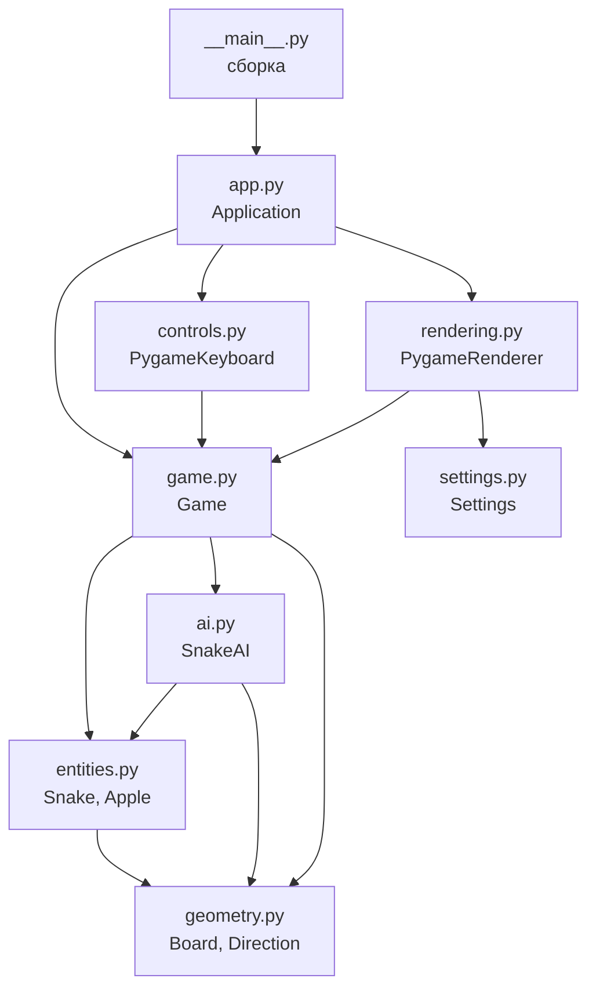

<div align="center">

# :snake: The Snake

**Классическая «Змейка» на Python и pygame с AI-алгоритмами**

[](https://www.python.org/)


</div>

---

## :video_game: О проекте

**The Snake** — реализация легендарной игры «Змейка». Змейка ползёт по сетке, поедает яблоки и растёт. Стен нет: выйдя за край поля, она появляется с противоположной стороны. Но осторожнее: врезавшись в собственный хвост, вы проиграете. :skull:

Проект начинался как учебный и был переписан по принципам ООП и SOLID: правила игры, ввод и отрисовка разделены, поэтому логику можно проверять тестами без окна.

## :sparkles: Возможности

- :apple: Яблоко появляется в случайной свободной клетке поля
- :chart_with_upwards_trend: Змейка растёт после каждого съеденного яблока, счёт виден в заголовке окна
- :cyclone: Проход сквозь границы поля (тороидальное поле)
- :no_entry_sign: Защита от мгновенного разворота на 180°
- :pause_button: Пауза: мир замирает, поверх поля появляется надпись «ПАУЗА»
- :checkered_flag: Экран GAME OVER с итоговым счётом и перезапуском по пробелу
- :robot: AI-режимы: Greedy, BFS и A*, переключаются прямо во время игры
- :gear: Настройки (размеры, цвета, тексты, скорость) собраны в одном месте
- :test_tube: Набор автотестов на pytest, которые работают без экрана

## :keyboard: Управление

| Клавиша | Действие                            |
| :-----: |-------------------------------------|
| :arrow_up: :arrow_down: :arrow_left: :arrow_right: | Двигаться (в режиме игрока)         |
| `1` | Управление игроком (AI выключен)    |
| `2` | AI: Greedy                          |
| `3` | AI: BFS                             |
| `4` | AI: A*                              |
| `Esc` | Пауза / продолжить                  |
| `Space` | Начать заново (на экране GAME OVER) |

Закрытие окна завершает игру. Пока включён AI, стрелки не работают: чтобы взять управление, нажмите `1`. Выбранный режим сохраняется при перезапуске.

Режим управления виден в заголовке окна:

```text
Snake by Mark Lee  |  Score: 7  |  AI: Off
Snake by Mark Lee  |  Score: 7  |  AI: On (BFS)
```

## :rocket: Быстрый старт

**1. Склонируйте репозиторий**

```bash
git clone https://github.com/Impossibruuuu/the-snake.git
```

**2. Создайте и активируйте виртуальное окружение**

```bash
python -m venv venv

# Linux / macOS
source venv/bin/activate

# Windows
venv\Scripts\activate
```

**3. Установите зависимости**

```bash
pip install -r requirements.txt
```

> :warning: Проект использует **pygame-ce**. Пакеты `pygame` и `pygame-ce` конфликтуют: если в окружении уже стоит `pygame`, сначала выполните `pip uninstall pygame`.

**4. Запустите игру**

```bash
python -m snake_game
```

> :bulb: Нужен **Python 3.12+**: код использует инструкцию `type` для псевдонимов типов (разрабатывался на 3.14).

## :test_tube: Тесты

```bash
pytest
```

Тесты запускаются без окна: pygame работает через «пустые» драйверы SDL. Для каждого теста действует таймаут (`pytest-timeout`, настройка в `pytest.ini`), поэтому зависший игровой цикл не повесит прогон.

| Файл | Что проверяет |
| ---- | ------------- |
| `test_geometry.py`, `test_entities.py` | Поле, проход сквозь границы, змейка, яблоко |
| `test_game.py` | Правила, пауза, GAME OVER, перезапуск, переключение AI |
| `test_ai.py` | Алгоритмы: кратчайшие пути, обход тела, качество партий |
| `test_controls.py` | Клавиши → команды игры |
| `test_rendering.py` | Реальные пиксели, надписи, заголовок окна |
| `test_app.py`, `test_main.py` | Игровой цикл и сборка приложения |

## :building_construction: Архитектура

Код разделён на три слоя:

- **Ядро** (`geometry`, `entities`, `ai`, `game`) хранит правила игры и не знает о pygame.
- **Адаптеры** (`controls`, `rendering`) превращают события pygame в команды и рисуют состояние игры.
- **Сборка** (`__main__`, `app`) создаёт объекты и запускает цикл.

Зависимости идут только сверху вниз: ядро ничего не знает об адаптерах.



### Структура проекта

```text
the-snake/
├── snake_game/
│   ├── __main__.py    # точка входа, сборка зависимостей
│   ├── app.py         # Application: игровой цикл
│   ├── game.py        # Game, GameState, Command: правила и состояние
│   ├── entities.py    # Snake, Apple
│   ├── geometry.py    # Board, Direction, Cell
│   ├── ai.py          # SnakeAI: Greedy, BFS, A*
│   ├── controls.py    # PygameKeyboard: клавиши → команды
│   ├── rendering.py   # PygameRenderer: отрисовка
│   └── settings.py    # Settings, Palette, Texts
├── tests/
├── pytest.ini
└── requirements.txt
```

### Классы

| Класс | Ответственность |
| ----- | --------------- |
| `Board` | Размер поля, шаг с проходом сквозь границы, расстояние, свободные клетки |
| `Direction` | Четыре направления и противоположное направление |
| `Snake` | Тело в `deque` (голова — первый элемент), поворот, шаг, рост, самоукус |
| `Apple` | Клетка яблока, перенос в случайную свободную клетку |
| `SnakeAI` | Интерфейс алгоритма: `choose_direction(snake, target, board)` |
| `GreedyAI`, `BFSAI`, `AStarAI` | Реализации алгоритмов |
| `Command` | Команды игрока, не привязанные к клавишам |
| `GameState` | Режимы: `RUNNING`, `PAUSED`, `GAME_OVER` |
| `Game` | Владелец состояния партии: счёт, змейка, яблоко, режим, AI. Применяет команды и делает игровой шаг |
| `PygameKeyboard` | Преобразует события pygame в команды |
| `PygameRenderer` | Рисует поле, змейку, яблоко, оверлеи и заголовок окна |
| `Application` | Игровой цикл. Работает с `InputSource`, `Renderer` и `FrameClock`, а не с pygame напрямую |
| `Settings` | Неизменяемые настройки: размеры, цвета, тексты, скорость |

### Игровой цикл

Каждый кадр `Application.run()` выполняет:

1. :hourglass_flowing_sand: Ограничение скорости через `clock.tick()`
2. :joystick: Чтение ввода: `controls.poll()` возвращает список команд
3. :speech_balloon: Применение команд: `game.handle(command)`
4. :footprints: Игровой шаг `game.update()`: AI выбирает направление, змейка двигается, проверяются поедание яблока и самоукус
5. :paintbrush: Отрисовка кадра: `renderer.render(game)`

На паузе и после конца игры `update()` ничего не делает, но кадры продолжают рисоваться.

### Как расширять

| Задача | Что менять                                                             |
| ------ |------------------------------------------------------------------------|
| Другая клавиша для команды | `DEFAULT_BINDINGS` в `controls.py`                                     |
| Новый AI | Класс в `ai.py`, комманда в `Command`, клавиша, строка в `__main__.py` |
| Новое состояние (меню, победа) | `GameState`, `Game.handle()`/`update()`, оверлей в `PygameRenderer`    |
| Цвета, размеры, тексты, скорость | `settings.py`                                                          |

## :robot: AI-режимы

| Режим | Как работает |
| ----- | ------------ |
| Greedy | Каждый шаг выбирает безопасный ход, который сильнее всего приближает голову к яблоку |
| BFS | Поиск в ширину: кратчайший путь к яблоку в обход тела |
| A* | Поиск с эвристикой расстояния до яблока: тоже кратчайший путь |

Расстояния считаются с учётом прохода сквозь границы. Алгоритмы не заглядывают вперёд дальше яблока, поэтому длинная змейка со временем может запереть себя. Если пути к яблоку нет, змейка едет прямо, а при препятствии выбирает любой безопасный ход.

## :straight_ruler: Параметры поля

| Параметр | Значение |
| -------- | -------- |
| Размер окна | 640 × 480 px |
| Размер клетки (`cell_size`) | 20 × 20 px |
| Сетка | 32 × 24 клетки |
| Скорость (`fps`) | 20 кадров в секунду |

Значения по умолчанию заданы в `Settings` (`snake_game/settings.py`), цвета и тексты — в `Palette` и `Texts`.

## :hammer_and_wrench: Технологии

- :snake: Python
- :video_game: pygame-ce
- :test_tube: pytest, pytest-timeout
- :computer: PyCharm

## :seedling: Идеи для развития

- [x] Счёт в заголовке окна
- [x] AI Snake: Greedy, BFS, A*
- [ ] Рекорд между партиями
- [ ] AI, который не запирает себя (например, обход по циклу Гамильтона)
- [ ] Ускорение игры по мере роста змейки
- [ ] Препятствия и разные виды еды

## :bust_in_silhouette: Автор

**Impossibruuuu** — [GitHub](https://github.com/Impossibruuuu) | [Stepik](https://stepik.org/users/634087689/profile) | [CodeWars](https://www.codewars.com/users/Impossibruuu)

---

<div align="center">

Сделано с :heart: и :snake:

</div>
